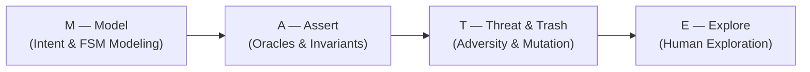
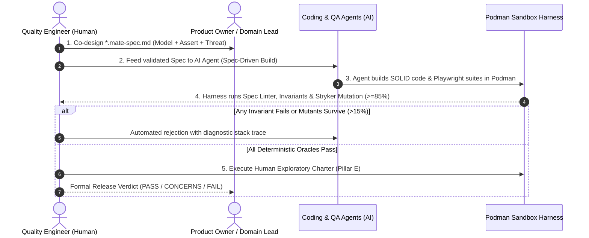

# 🧉 The M.A.T.E. Method Manifesto
## Spec-Driven Testing (SDT) for the Agentic AI Era

> *"AI-generated implementation code is ephemeral and disposable.  
> The specification, deterministic oracles, and human critical thinking are the only permanent assets of software engineering."*  
> — **Antonio "Tony" Crespo**, Creator of the M.A.T.E. Method (*Un Junior En Apuros*)

---

## 📜 Prologue: The Quality Crisis in the Agentic Era

Over the past twenty years, the software industry attempted to discipline the quality process through trends and acronyms:
*   **TDD (Test-Driven Development)** promised emergent design by writing unit tests first, yet often devolved into syntactic micro-checks that fail to capture macro business intent.
*   **BDD (Behavior-Driven Development)** tried to bridge business stakeholders and developers through Gherkin syntax (`Given / When / Then`), only to become buried under a bureaucracy of unmaintainable step definitions that nobody reads and teams abandon within three sprints.
*   Then came **Generative AI and "Vibe Coding"**: developers and Large Language Models generating thousands of lines of code per minute from vague, informal prompts—unleashing the largest wave of technical debt, logic hallucinations, and security vulnerabilities in computing history.

In the Agentic Era (2026+), humans no longer type the majority of implementation code: autonomous agents generate it.  
When machines write the application code and testing is reduced to asking another machine to "generate generic unit tests," software quality collapses. LLMs are compliance-seeking engines: if you do not explicitly define how the system must fail, they will hallucinate solutions that *appear* to pass while silently corrupting production data.

That is why the **M.A.T.E. Method** was born.  
It is not another cosmetic wrapper library. It is a **Spec-Driven Testing (SDT) methodology** engineered by and for **Quality Engineers** to govern software agents, reclaim architectural control, and restore the tester's rightful role: **Supreme Architect and Guardian of Software Quality**.

---

## ⚖️ The 4 Core Values of M.A.T.E.

Through real-world engineering in the trenches, we have come to value:

```text
┌──────────────────────────────────────────────┬──────────────────────────────────────────────┐
│ We value MORE:                               │ Over:                                        │
├──────────────────────────────────────────────┼──────────────────────────────────────────────┤
│ 1. Explicit Intent & Immutable Contracts     │ Autogenerated implementation code            │
│ 2. Deterministic Oracles & Invariants        │ Cosmetic "happy-path" checking               │
│ 3. Adversity, Malice & Chaos Engineering     │ Naive assumptions that infrastructure holds  │
│ 4. Human Judgment & Exploratory Testing      │ Blind, bureaucratic test automation          │
└──────────────────────────────────────────────┴──────────────────────────────────────────────┘
```

That is, while there is value in the items on the right, **the items on the left are what save organizations from catastrophe.**

---

## 🏛️ The 4 Pillars of the M.A.T.E. Method

The **M.A.T.E.** acronym defines the four non-negotiable layers of a modern quality specification:



---

### 1. 🗺️ M — Model (Intent, State Machines & Contracts)

> *"If you cannot model the system on a napkin while drinking a mate, your AI agents will hallucinate garbage."*

In M.A.T.E., testing does not begin after the code is written; it begins by formally modeling the problem before a single line of business logic exists.

*   **Finite State Machines (FSM):** Every business workflow (shopping cart, order fulfillment, payment lifecycle, authentication) is modeled as an explicit state machine: valid states, legal transitions, and **strictly forbidden transitions** (where 90% of critical exploits live).
*   **Immutable Technical Contracts:** Rigorous data schemas (OpenAPI, JSON Schema, strict TypeScript interfaces with zero `any`).
*   **Operational Boundaries:** What the module is permitted to touch and what is strictly off-limits (Principle of Least Privilege).

A specification is not a forgotten Word document; it is a machine-readable, Git-versioned source of truth (`specs/[module].mate-spec.md`).

---

### 2. 🎯 A — Assert (Deterministic Oracles & Sacred Invariants)

> *"A test that does not validate a mathematical invariant is merely an illusion to paint the CI pipeline green."*

AI agents excel at writing tests that pass without proving anything (blind mocks, trivial checks like `expect(response).toBeDefined()`).  
Pillar **Assert** establishes **Non-Negotiable Acceptance Oracles**:

*   **Business Invariants:** Mathematical rules that must **never** be violated under any state transition (e.g., *"Account balance must never drop below zero"*, *"The sum of line items plus tax must match the invoiced total to the exact cent"*).
*   **SOLID & OOP Automation Architecture:** Enforces Single Responsibility (Page & Component Object Models), Open/Closed abstractions, and Dependency Inversion via Playwright fixtures.
*   **Zero Arbitrary Sleeps:** Absolute prohibition of `sleep()` or `page.waitForTimeout()`. All synchronization must rely on deterministic events and auto-retrying web assertions.
*   **Performance & Resource Oracles:** Explicit SLAs measured by objective harnesses (e.g., *"P95 latency <= 400ms under 200 RPS sustained load inside a Podman container"*).

If AI-generated code violates a single invariant, the quality gate blocks the Pull Request in seconds.

---

### 3. 💣 T — Threat & Trash (Adversarial Engineering & Mutation Testing)

> *"Developers code so the application works. Quality Engineers design the spec so the application survives the apocalypse."*

By nature, LLMs are heavily biased toward the **Happy Path**. When prompted to build or test a feature, an LLM assumes flawless 5G connectivity, polite users entering well-formed ASCII strings, and third-party APIs that never time out.  
Pillar **Threat & Trash** injects professional tester malice directly into the specification:

*   **Threat Modeling for Testers:** How can a malicious actor, race condition, or network partition break this feature?
*   **Concurrency & Idempotency:** Compulsive double-clicks within 50ms, duplicate webhook storms, and simultaneous state mutations.
*   **Data Trash & Fuzzing:** 10MB payloads, Cyrillic/RTL scripts, emojis in numeric inputs, SQL/NoSQL injections, and Prompt Injection payloads in AI features.
*   **Mandatory Mutation Testing:** Subjecting the test suite itself to mutation testing (Stryker Mutator) inside rootless **Podman** containers. If we mutate production logic and no test fails, the tests are smoke and mirrors. **M.A.T.E. Threshold: Mutation Score >= 85%**.

---

### 4. 🧭 E — Explore (Human Judgment & Exploratory Charters)

> *"Machines perform checking; humans perform testing. Never let a robot decide whether software is humane and trustworthy to use."*

Rooted in the foundational principles of *Rapid Software Testing* (RST), M.A.T.E. recognizes that exhaustive automation only covers **Checking** (verifying whether the software satisfies rules we already knew to ask about).  
True quality requires **Testing**: exploration, learning, experiment design, and critical human judgment.

Pillar **Explore** explicitly reserves **Exploratory Testing Charters (Time-Boxed Human Missions)** inside every specification:
*   **Ergonomics & Usability:** Does the workflow feel effortless or is it a frustrating maze?
*   **Trust & Emotional Confidence:** Does the checkout transition inspire confidence or leave the user wondering if their card was charged twice?
*   **Accessibility (a11y) & Ethical Auditing:** Can a person using a screen reader and keyboard-only navigation complete the flow cleanly (WCAG 2.1 AA)?

Software **does not ship to production** until the human Quality Engineer signs off on the exploratory charter and issues the formal release verdict (`PASS`, `CONCERNS` with signed waiver, or `FAIL`).

---

## 📝 Anatomy of a M.A.T.E. Specification (`*.mate-spec.md`)

Every feature governed by M.A.T.E. has a structured specification file in `./specs/`. It combines YAML frontmatter with four XML-delimited semantic blocks so both humans and AI agents can parse it deterministically:

```markdown
---
module: laundry-order-lifecycle
version: 1.0.0
status: APPROVED
author: Tony Crespo (@crespoantonio)
---

# 🧉 MATE-SPEC: Laundry Order Lifecycle

<intent_model>
  <!-- Domain actors, context, Finite State Machine, and Forbidden Transitions -->
  ### Finite State Machine
  `PENDING -> PICKED_UP -> IN_WASH -> READY -> DELIVERED`

  ### Explicitly Forbidden Transitions
  - ⛔ `PENDING -> DELIVERED` (Illegal bypass of washing workflow)
  - ⛔ `DELIVERED -> IN_WASH` (Terminal states are immutable)
</intent_model>

<invariants>
  <!-- Non-negotiable mathematical rules and performance oracles -->
  - `INV-01`: No order can be created with `garment_count <= 0`.
  - `INV-02`: `total_amount` must strictly equal `sum(unit_price * qty) + delivery_fee - discount`.
  - `ORA-PERF`: `POST /api/orders` P95 latency <= 350ms under 250 RPS in Podman container.
</invariants>

<threat_scenarios>
  <!-- Concurrency, idempotency, fuzzing, and mutation governance -->
  - `THR-01` (Race Condition): Double-click on "Confirm Order" within 50ms must be strictly idempotent and create exactly ONE order.
  - `THR-02` (Concurrent Cancellation): User cancels order at the exact millisecond driver scans pickup QR; driver state transition prevails.
  - `THR-MUTATION`: Mutation Score >= 85% verified with Stryker Mutator in rootless Podman.
</threat_scenarios>

<exploratory_charters>
  <!-- Time-boxed human exploratory missions (SBTM) -->
  - **Charter EXP-01 (45 min):** Explore garment selection flow on low-end mobile viewport over throttled 3G. Focus: visual feedback, error recovery, and WCAG 2.1 AA keyboard navigation.
</exploratory_charters>
```

---

## 🔄 The M.A.T.E. Lifecycle (The MATE Loop)

The methodology operates as a closed five-stage engineering loop:



---

## 📜 The 10 Commandments of the M.A.T.E. Quality Engineer

1.  **Thou shalt not automate without a spec:** Never write a test script unless an explicit invariant exists in a `*.mate-spec.md` file.
2.  **Thou shalt not trust green AI tests blindly:** An AI-written test is suspect until it kills at least 85% of code mutants in Stryker.
3.  **Thou shalt separate checking from testing:** Let machines execute repetitive checking at lightning speed; reserve exploratory testing and lateral thinking for the human mind.
4.  **Thou shalt tolerate zero arbitrary sleeps:** `sleep()` and `waitForTimeout()` are banned. Synchronization is event-driven with auto-retrying web assertions.
5.  **Thou shalt isolate destructive executions:** No untrusted AI-generated code or mutation suite runs on the bare host without rootless **Podman** container isolation.
6.  **The specification is the single source of truth:** If the code disagrees with the spec, the code is broken. If business requirements evolve, update and validate the spec first, then regenerate the code.
7.  **Thou shalt inject malice from Day Zero:** Thinking about how to break the system is not an afterthought at the end of the sprint; it is Pillar *Threat* during design.
8.  **Thou shalt enforce idempotency:** Every network retry, webhook, or async callback must be designed and tested against duplicate delivery.
9.  **Thou shalt govern releases with formal waivers:** If a release ships with `[CONCERNS]`, technical debt is signed by both the Quality Lead and Tech Lead with an auditable tracker ticket.
10. **Thou shalt remember software serves humans:** No green CI pipeline compensates for a frustrating, inaccessible, or deceptive user experience. Empathy for the human user is the supreme measure of quality.

---

## ✍️ Authorship & Open Source Community

The **M.A.T.E. Method** was conceived and created by **Antonio "Tony" Crespo** as the foundational Spec-Driven Testing framework of the **Un Junior En Apuros** engineering community.

It is an open-source project built for Quality Engineers, SDETs, testers, and software developers worldwide who refuse to be passive spectators in the AI revolution.

*Brew a good mate, open your spec, armor your oracles, and build indestructible software.*

**Buenos Aires, Argentina — 2026+**  
*Official Repository: [github.com/crespoantonio/mate-sdt](https://github.com/crespoantonio/mate-sdt)*
