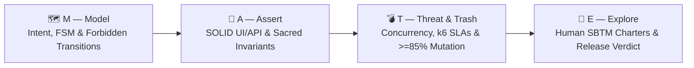

# 🧉 M.A.T.E. Method (`mate-sdt`)

### Spec-Driven Testing (SDT) Framework, 10 AI Agent Skills & 5 E2E Workflows for the Agentic Coding Era

[](https://www.npmjs.com/package/mate-sdt)
[](./LICENSE)
[](https://nodejs.org)
[](https://stryker-mutator.io/)
[](https://podman.io/)

> *"AI-generated implementation code is ephemeral and disposable.  
> The specification, deterministic oracles, and human critical thinking are the only permanent assets of software engineering."*  
> — **Antonio "Tony" Crespo**, Creator of the M.A.T.E. Method (*Un Junior En Apuros*)

---

## ⚡ Quick Start (Install in Any Project in 10 Seconds)

Run the interactive installer at the root of your repository using `npx`:

```bash
npx mate-sdt install
```

Or run non-interactively with default settings across your favorite AI coding agents (and optionally install `@playwright/cli` + `@playwright/test`):

```bash
npx mate-sdt install --yes --with-playwright-cli --ide antigravity,claude,cursor,windsurf,copilot
```

---

## 🌟 Why M.A.T.E.? The Problem with Testing in the AI Era

In the Agentic Era (2026+), autonomous AI agents write thousands of lines of code in seconds. Traditional testing approaches were not built for this reality:

*   **TDD (Test-Driven Development)** focuses on low-level unit syntax, missing macro business state machines.
*   **BDD (Behavior-Driven Development)** drowns engineering teams in brittle Gherkin (`Given/When/Then`) step-definition bureaucracy that gets abandoned within three sprints.
*   **"Vibe Coding" + AI-Generated Tests** produce cosmetic "happy-path" checks (`expect(res).toBeDefined()`) that paint the CI pipeline green while silently shipping race conditions, security exploits, and broken business invariants to production.

**The M.A.T.E. Method** is a **Spec-Driven Testing (SDT)** framework that flips the paradigm: **the specification belongs to the Quality Engineer**. It equips both human engineers and AI coding agents (Google Antigravity, Claude Code, Cursor, Windsurf, GitHub Copilot) with a rigorous, token-efficient architecture governed by four pillars, **10 specialized AI skills** (including **`mate-playwright-cli`** powered by `@playwright/cli`), and **5 end-to-end workflows**.

---

## 🏛️ The 4 Pillars of M.A.T.E.



| Pillar | Name | Core Responsibility | Key Artifact / Enforcement |
| :---: | :--- | :--- | :--- |
| **M** | **Model** | Eradicate ambiguity before code exists. Model Finite State Machines (FSM), **Explicit Forbidden Transitions**, strict contracts, and Live Page Reconnaissance (`page-explorer`). | `specs/[module].mate-spec.md` (`<intent_model>`) |
| **A** | **Assert** | Translate mathematical invariants into OOP/SOLID Playwright UI & API suites (`BasePage`, `ComponentObject`, `BaseApiClient`, Dependency Inversion fixtures, **zero arbitrary sleeps**). | `specs/[module].mate-spec.md` (`<invariants>`) + `src/pages/`, `src/api/`, `src/fixtures/` |
| **T** | **Threat & Trash** | Shatter the happy-path illusion: race conditions, double-click idempotency, payload fuzzing, **k6 Performance SLAs**, and **Stryker Mutation Testing (>= 85%)** inside rootless **Podman** containers. | `specs/[module].mate-spec.md` (`<threat_scenarios>`) + `stryker.config.json` + `tests/nfr/*.k6.js` |
| **E** | **Explore** | Safeguard human quality via Session-Based Test Management (SBTM) charters (ergonomics, WCAG 2.1 AA accessibility, trust) and issue the formal release verdict: `PASS`, `CONCERNS` (with signed waiver), or `FAIL`. | `tests/charters/CHR-*.md` & `specs/waivers/WVR-*.md` |

---

## 🧩 The 10 AI Agent Skills & 5 End-to-End Workflows

When you run `npx mate-sdt install`, your AI agents gain **10 specialized skills** and **5 orchestrated E2E workflows**:

### 1. The 10 M.A.T.E. Skills (`skills/`)
| Skill | Scope | Description |
| :--- | :--- | :--- |
| **`mate-core`** | **Orchestrator** | Manages `MATE-PROJECT-MAP.md`, SOLID/OOP rules, Handling Uncertainty Protocol (`[OBSERVED]` vs `[INFERRED]`), and Java/Python polyglot adapters. |
| **`mate-model`** | **Pillar M** | Authors `*.mate-spec.md`, Finite State Machines, Forbidden Transitions, and **Live Page Reconnaissance** via Playwright CLI / MCP. |
| **`mate-assert-playwright`** | **Pillar A (UI)** | Generates SOLID Page Objects, Component Objects, and DIP fixtures with zero arbitrary sleeps. |
| **`mate-playwright-cli`** | **Pillar M/A/T/E (Browser CLI)** | M.A.T.E.-engineered `@playwright/cli` skill + 10 deep-dive guides enforcing SOLID POM (`BasePage`), COM (`BaseComponent`), `test.extend` DIP fixtures, network mocking, multi-actor sessions, traces & video. |
| **`mate-assert-api`** | **Pillar A (API)** | Generates OpenAPI/Swagger contract test matrices (`2xx`, `400/422`, `401/403` BOLA, `409` FSM) and typed API clients. |
| **`mate-threat`** | **Pillar T (Chaos)** | Concurrency, race conditions, webhook idempotency, fuzzing, and Stryker Mutation (`>= 85%`) in Podman. |
| **`mate-performance-k6`** | **Pillar A/T (NFR)** | Designs Smoke, Load, Stress, Spike, and Soak profiles in Grafana k6 enforcing `<performance_oracles>` in Podman. |
| **`mate-explore`** | **Pillar E** | Designs human SBTM exploratory charters, WCAG 2.1 AA audits, Release Waivers, and Release Verdicts. |
| **`mate-triage`** | **Day-2 Ops** | Triages CI failures (`Bug` vs `Flaky` vs `Infra` vs `Data`) and generates spec-linked Bug Reports (`npx mate-sdt bug`). |
| **`mate-maintenance`** | **Day-2 Ops** | Audits test codebase health (`A`–`F`), detecting `waitForTimeout`/sleeps, `.only` locks, and DIP violations (`npx mate-sdt audit`). |

### 2. The 5 End-to-End Workflows (`workflows/`)
| Workflow Command | End-to-End Pipeline |
| :--- | :--- |
| **`/mate-flow-greenfield`** | Idea/Requirement ➔ `*.mate-spec.md` ➔ `validate` ➔ UI/API SOLID Tests ➔ Podman Mutation (`>=85%`) ➔ Human Charter & Verdict |
| **`/mate-flow-brownfield`** | Legacy Code / Live URL Recon (`page-explorer`) ➔ `MATE-PROJECT-MAP.md` ➔ Reverse-Spec (`REVIEW`) ➔ Freeze P0 Invariants |
| **`/mate-flow-api-contract`** | OpenAPI/Swagger ➔ Contract Spec & Forbidden Transitions ➔ Typed `BaseApiClient` + Contract & Fuzzing Suite |
| **`/mate-flow-performance`** | `<performance_oracles>` SLAs ➔ k6 Load Profile Design ➔ Rootless Podman Execution (`npx mate-sdt k6`) |
| **`/mate-flow-triage`** | CI Failure Logs ➔ Root-Cause Triage ➔ Spec-Linked Bug Report (`npx mate-sdt bug`) or Suite Refactor (`npx mate-sdt audit`) |

---

## 🧠 Token-Efficient AI Architecture (`MATE-PROJECT-MAP.md`)

Instead of forcing AI agents to burn 100k+ tokens scanning your entire repository on every prompt, `mate-sdt` maintains a **Living Architecture & QA Context Index** (`MATE-PROJECT-MAP.md`) at the root of your project:

```text
your-project/
├── MATE-PROJECT-MAP.md          <-- [CRITICAL] Living architecture & QA context index
├── specs/                       <-- M.A.T.E. specifications & release waivers
│   ├── TEMPLATE_MATE_SPEC.md
│   ├── waivers/
│   └── sample-order-lifecycle.mate-spec.md
├── tests/
│   ├── e2e/                     <-- P0/P1 end-to-end UI workflows
│   ├── api/                     <-- Contract and API integration suites
│   ├── threats/                 <-- Concurrency, idempotency, race conditions & fuzzing
│   ├── nfr/                     <-- Performance (k6) and resilience scripts (*.k6.js)
│   ├── charters/                <-- Human exploratory testing sessions (CHR-*.md)
│   └── bugs/                    <-- Structured bug reports linked to invariants (BUG-*.md)
├── src/
│   ├── pages/                   <-- SOLID Page Object Model (SRP / OCP)
│   ├── components/              <-- Reusable UI Component Objects
│   ├── api/                     <-- Typed API Clients & Request Builders
│   ├── fixtures/                <-- Dependency Inversion (DIP) Playwright fixtures
│   └── models/                  <-- Strict TypeScript contracts (zero `any`)
└── stryker.config.json          <-- Mutation testing governance (>= 85% break threshold)
```

---

## 🛠️ CLI Commands Reference

`mate-sdt` provides a zero-dependency CLI for scaffolding, linting specifications, auditing test health, managing charters/bugs/waivers, and running containerized mutation & k6 suites:

| Command | Description |
| :--- | :--- |
| `npx mate-sdt install` | Launch the interactive installer (choose Greenfield/Brownfield mode, target AI IDEs, starter templates, and `@playwright/cli` installation). |
| `npx mate-sdt init [dir]` | Quickly scaffold the M.A.T.E. directory structure, `MATE-PROJECT-MAP.md`, and `stryker.config.json`. |
| `npx mate-sdt setup-playwright [dir]` | Install `@playwright/cli@latest` and `@playwright/test@latest` in the target project and configure `.gitignore`. |
| `npx mate-sdt validate [path]` | Lint one or all `*.mate-spec.md` files (verifies YAML frontmatter, 4 XML blocks, explicit Forbidden Transitions, and `INV-XX` IDs). |
| `npx mate-sdt audit [dir]` | Scan test codebase for M.A.T.E. anti-patterns (`waitForTimeout`, `sleep`, `.only`, DIP violations) and compute Health Score (`A`–`F`). |
| `npx mate-sdt mutate [dir]` | Execute Stryker Mutator inside an isolated, rootless **Podman** container enforcing the `>= 85%` mutation score threshold. |
| `npx mate-sdt k6 [script]` | Execute Grafana k6 performance suite inside an isolated, rootless **Podman** container validating `<performance_oracles>`. |
| `npx mate-sdt charter <module>` | Generate a timestamped human Exploratory Testing Charter (SBTM) in `tests/charters/`. |
| `npx mate-sdt bug <module>` | Generate a Structured Bug Report linked to broken spec invariants in `tests/bugs/`. |
| `npx mate-sdt waiver <module>` | Generate a Formal Release Waiver in `specs/waivers/` when a release verdict is `[CONCERNS]`. |
| `npx mate-sdt status [dir]` | Run a complete governance audit (checks Living Map, IDE skills, spec validity, Health Score, and Podman availability). |

---

## 📚 Documentation & Manifesto

*   📜 [**The M.A.T.E. Manifesto (`MANIFESTO.md`)**](./MANIFESTO.md) — Philosophy, the 4 Core Values, the MATE Loop diagram, and the 10 Commandments of the M.A.T.E. Quality Engineer.
*   🚀 [**Getting Started Guide (`docs/GETTING_STARTED.md`)**](./docs/GETTING_STARTED.md) — Step-by-step walkthrough from installation to release verdict.
*   📐 [**Specification Standard (`docs/SPEC_STANDARD.md`)**](./docs/SPEC_STANDARD.md) — Complete reference for authoring `*.mate-spec.md` files.
*   💻 [**CLI Reference (`docs/CLI_REFERENCE.md`)**](./docs/CLI_REFERENCE.md) — Detailed options, flags, and CI/CD integration examples.
*   📦 [**Publishing & Maintainer Guide (`docs/PUBLISHING.md`)**](./docs/PUBLISHING.md) — How to publish and update `mate-sdt` on NPM.

---

## 📄 License & Authorship

Created by **Antonio "Tony" Crespo** — Founder of **Un Junior En Apuros**.  
Licensed under the [MIT License](./LICENSE).
