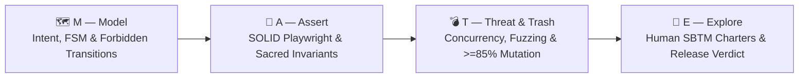

# 🧉 M.A.T.E. Method (`mate-sdt`)

### Spec-Driven Testing (SDT) Framework & AI Agent Governance for the Agentic Coding Era

[](https://www.npmjs.com/package/mate-sdt)
[](./LICENSE)
[](https://nodejs.org)
[](https://stryker-mutator.io/)
[](https://podman.io/)

> *"AI-generated implementation code is ephemeral and disposable.  
> The specification, deterministic oracles, and human critical thinking are the only permanent assets of software engineering."*  
> — **Antonio "Tony" Crespo**, Creator of the M.A.T.E. Method (*Un Junior En Apuros*)

---

## ⚡ Quick Start (Install in Any Project in 10 Seconds)

Run the interactive installer at the root of your repository using `npx`:

```bash
npx mate-sdt install
```

Or run non-interactively with default settings across your favorite AI coding agents:

```bash
npx mate-sdt install --yes --ide antigravity,claude,cursor,windsurf,copilot
```

---

## 🌟 Why M.A.T.E.? The Problem with Testing in the AI Era

In the Agentic Era (2026+), autonomous AI agents write thousands of lines of code in seconds. Traditional testing approaches were not built for this reality:

*   **TDD (Test-Driven Development)** focuses on low-level unit syntax, missing macro business state machines.
*   **BDD (Behavior-Driven Development)** drowns engineering teams in brittle Gherkin (`Given/When/Then`) step-definition bureaucracy that gets abandoned within three sprints.
*   **"Vibe Coding" + AI-Generated Tests** produce cosmetic "happy-path" checks (`expect(res).toBeDefined()`) that paint the CI pipeline green while silently shipping race conditions, security exploits, and broken business invariants to production.

**The M.A.T.E. Method** is a **Spec-Driven Testing (SDT)** framework that flips the paradigm: **the specification belongs to the Quality Engineer**. It equips both human engineers and AI coding agents (Google Antigravity, Claude Code, Cursor, Windsurf, GitHub Copilot) with a rigorous, token-efficient architecture governed by four pillars.

---

## 🏛️ The 4 Pillars of M.A.T.E.



| Pillar | Name | Core Responsibility | Key Artifact / Enforcement |
| :---: | :--- | :--- | :--- |
| **M** | **Model** | Eradicate ambiguity before code exists. Model Finite State Machines (FSM), **Explicit Forbidden Transitions**, and strict TypeScript/JSON contracts. | `specs/[module].mate-spec.md` (`<intent_model>`) |
| **A** | **Assert** | Translate mathematical invariants into OOP/SOLID Playwright suites (Page & Component Object Models, Dependency Inversion fixtures, **zero arbitrary sleeps**). | `specs/[module].mate-spec.md` (`<invariants>`) + `src/pages/`, `src/fixtures/` |
| **T** | **Threat & Trash** | Shatter the happy-path illusion: race conditions, double-click idempotency, payload fuzzing, and **Stryker Mutation Testing (>= 85%)** inside rootless **Podman** containers. | `specs/[module].mate-spec.md` (`<threat_scenarios>`) + `stryker.config.json` |
| **E** | **Explore** | Safeguard human quality via Session-Based Test Management (SBTM) charters (ergonomics, WCAG 2.1 AA accessibility, trust) and issue the formal release verdict: `PASS`, `CONCERNS` (with signed waiver), or `FAIL`. | `tests/charters/CHR-*.md` & `specs/waivers/WVR-*.md` |

---

## 🧠 Token-Efficient AI Architecture (`MATE-PROJECT-MAP.md`)

Instead of forcing AI agents to burn 100k+ tokens scanning your entire repository on every prompt, `mate-sdt` maintains a **Living Architecture Index** (`MATE-PROJECT-MAP.md`) at the root of your project:

```text
your-project/
├── MATE-PROJECT-MAP.md          <-- [CRITICAL] Living architecture index for AI agents & humans
├── specs/                       <-- M.A.T.E. specifications & release waivers
│   ├── TEMPLATE_MATE_SPEC.md
│   ├── waivers/
│   └── sample-order-lifecycle.mate-spec.md
├── tests/
│   ├── e2e/                     <-- P0/P1 end-to-end user workflows
│   ├── api/                     <-- Contract and API integration suites
│   ├── threats/                 <-- Concurrency, idempotency, race conditions & fuzzing
│   ├── charters/                <-- Human exploratory testing sessions (SBTM)
│   └── nfr/                     <-- Performance (k6) and resilience tests
├── src/
│   ├── pages/                   <-- SOLID Page Object Model (SRP / OCP)
│   ├── components/              <-- Reusable UI Component Objects
│   ├── fixtures/                <-- Dependency Inversion (DIP) Playwright fixtures
│   └── models/                  <-- Strict TypeScript contracts (zero `any`)
└── stryker.config.json          <-- Mutation testing governance (>= 85% break threshold)
```

---

## 🤖 Supported AI Coding Agents & IDEs

When you run `npx mate-sdt install`, the installer configures specialized skills, slash commands, and context rules for your chosen tools:

| AI Agent / IDE | Installed Artifacts | How to Invoke |
| :--- | :--- | :--- |
| **Google Antigravity (`agy`)** | `.agents/skills/mate-*` + `.agent/skills.json` | Automatically discovered skills: `mate-core`, `mate-model`, `mate-assert-playwright`, `mate-threat`, `mate-explore` |
| **Claude Code** | `.claude/commands/mate-*.md` + `CLAUDE.md` | Slash commands: `/mate-core`, `/mate-model`, `/mate-assert-playwright`, `/mate-threat`, `/mate-explore` |
| **Cursor** | `.cursor/rules/mate-*.mdc` | Context-aware `.mdc` rules automatically attached by file glob |
| **Windsurf** | `.windsurf/rules/mate-sdt.md` | Workspace-level Cascade Spec-Driven Testing rules |
| **GitHub Copilot** | `.github/copilot-instructions.md` + `.github/prompts/*.prompt.md` | Repository instructions + reusable prompt files |

---

## 🛠️ CLI Commands Reference

`mate-sdt` provides a zero-dependency CLI for scaffolding, linting specifications, managing exploratory charters, and running containerized mutation tests:

| Command | Description |
| :--- | :--- |
| `npx mate-sdt install` | Launch the interactive installer (choose Greenfield/Brownfield mode, target AI IDEs, and starter templates). |
| `npx mate-sdt init [dir]` | Quickly scaffold the M.A.T.E. directory structure, `MATE-PROJECT-MAP.md`, and `stryker.config.json`. |
| `npx mate-sdt validate [path]` | Lint one or all `*.mate-spec.md` files (verifies YAML frontmatter, 4 XML blocks, explicit Forbidden Transitions, and `INV-XX` IDs). |
| `npx mate-sdt mutate [dir]` | Execute Stryker Mutator inside an isolated, rootless **Podman** container enforcing the `>= 85%` mutation score threshold. |
| `npx mate-sdt charter <module>` | Generate a timestamped human Exploratory Testing Charter (SBTM) in `tests/charters/`. |
| `npx mate-sdt waiver <module>` | Generate a Formal Release Waiver in `specs/waivers/` when a release verdict is `[CONCERNS]`. |
| `npx mate-sdt status [dir]` | Run a complete governance audit (checks Living Map, IDE skills, spec validity, and Podman availability). |

---

## 🔄 Greenfield vs. Brownfield Workflows

### 🌱 Greenfield Mode (Building New Features from Scratch)
1. **Model (`mate-model`):** Co-design `specs/<feature>.mate-spec.md` with your Product Owner or AI agent, explicitly declaring legal and **forbidden state transitions**.
2. **Validate:** Run `npx mate-sdt validate` to ensure structural compliance.
3. **Assert (`mate-assert-playwright`):** Generate SOLID Page Objects, Component Objects, DIP fixtures, and invariant tests before writing application code.
4. **Build:** Let your coding agent implement the feature until all deterministic assertions turn green.
5. **Threat (`mate-threat`):** Execute adversarial race-condition suites and run `npx mate-sdt mutate` inside Podman to verify a Mutation Score `>= 85%`.
6. **Explore (`mate-explore`):** Generate a human charter (`npx mate-sdt charter <feature>`), perform exploratory & accessibility testing, and sign the release verdict (`PASS`, `CONCERNS`, or `FAIL`).

### 🏭 Brownfield Mode (Legacy / Existing Codebases)
1. **Install:** Run `npx mate-sdt install` and select **Brownfield Mode**.
2. **Surface Scan (`mate-core` & `mate-model`):** Have your AI agent inspect existing API routes, controllers, and database schemas to infer the current state machine.
3. **Freeze Invariants:** Draft `specs/<legacy-module>.mate-spec.md` with status `REVIEW`, flagging accidental edge-case transitions as **Forbidden Transitions**.
4. **Index in `MATE-PROJECT-MAP.md`:** Map the legacy architecture so future agent sessions operate with surgical context.
5. **Armor Before Refactoring:** Lock P0 invariant tests in Playwright before allowing any refactoring of legacy code.

---

## 📚 Documentation & Manifesto

*   📜 [**The M.A.T.E. Manifesto (`MANIFESTO.md`)**](./MANIFESTO.md) — Philosophy, the 4 Core Values, the MATE Loop diagram, and the 10 Commandments of the M.A.T.E. Quality Engineer.
*   🚀 [**Getting Started Guide (`docs/GETTING_STARTED.md`)**](./docs/GETTING_STARTED.md) — Step-by-step walkthrough from installation to release verdict.
*   📐 [**Specification Standard (`docs/SPEC_STANDARD.md`)**](./docs/SPEC_STANDARD.md) — Complete reference for authoring `*.mate-spec.md` files.
*   💻 [**CLI Reference (`docs/CLI_REFERENCE.md`)**](./docs/CLI_REFERENCE.md) — Detailed options, flags, and CI/CD integration examples.
*   📦 [**Publishing & Maintainer Guide (`docs/PUBLISHING.md`)**](./docs/PUBLISHING.md) — How to publish and update `mate-sdt` on NPM.

---

## 🤝 Contributing

Contributions, issues, and feature requests are welcome! Please review [`CONTRIBUTING.md`](./CONTRIBUTING.md) before submitting a Pull Request.

```bash
# Run package integrity check and test suite
npm run build
npm test
```

---

## 📄 License & Authorship

Created by **Antonio "Tony" Crespo** — Founder of **Un Junior En Apuros**.  
Licensed under the [MIT License](./LICENSE).
