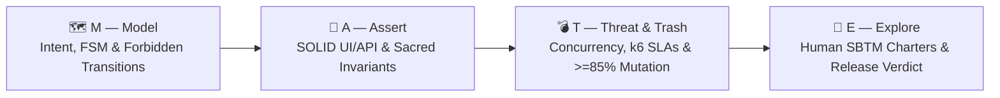

# 🧉 M.A.T.E. Method (`mate-sdt`)

### Spec-Driven Testing (SDT) Framework & QA Companion — 20 Synergistic AI Agent Skills (16 Core + 4 AI Pack) & 8 E2E Workflows for the Agentic Coding Era

[](https://www.npmjs.com/package/mate-sdt)
[](./LICENSE)
[](https://nodejs.org)
[](https://stryker-mutator.io/)
[](https://podman.io/)

> *"AI-generated implementation code is ephemeral and disposable.  
> The specification, deterministic oracles, and human critical thinking are the only permanent assets of software engineering."*  
> — **Antonio "Tony" Crespo**, Creator of the M.A.T.E. Method (*Un Junior En Apuros*)

---

## ⚡ Quick Start (Install in Any Project in 10 Seconds)

Run the interactive installer at the root of your repository using `npx`:

```bash
npx mate-sdt install
```

Or run non-interactively with default settings across your favorite AI coding agents (and optionally install `@playwright/cli` + `@playwright/test`):

```bash
npx mate-sdt install --yes --with-playwright-cli --ide antigravity,claude,cursor,windsurf,copilot,codex
```

---

## 🌟 Why M.A.T.E.? The Problem with Testing in the AI Era

In the Agentic Era (2026+), autonomous AI agents write thousands of lines of code in seconds. Traditional testing approaches were not built for this reality:

*   **TDD (Test-Driven Development)** focuses on low-level unit syntax, missing macro business state machines.
*   **BDD (Behavior-Driven Development)** drowns engineering teams in brittle Gherkin (`Given/When/Then`) step-definition bureaucracy that gets abandoned within three sprints.
*   **"Vibe Coding" + AI-Generated Tests** produce cosmetic "happy-path" checks (`expect(res).toBeDefined()`) that paint the CI pipeline green while silently shipping race conditions, security exploits, and broken business invariants to production.

**The M.A.T.E. Method** is a **Spec-Driven Testing (SDT)** framework and **Daily QA/QE Companion** that flips the paradigm: **the specification belongs to the Quality Engineer**. Built on the two foundational pillars of modern AI systems—**Context Engineering** (*Write, Select, Compress, Isolate*) and **Harness Engineering** ($\text{Agent} = \text{Model} + \text{Harness}$)—`mate-sdt` equips both human engineers and AI coding agents (Google Antigravity, Claude Code, Cursor, Windsurf, GitHub Copilot, OpenAI Codex CLI) with a rigorous, token-efficient architecture governed by four pillars, **20 specialized & synergistic AI skills** (16 core + 4 on-demand AI Agent/RAG pack), and **8 end-to-end workflows**.

---

## 🧠⚙️ Built on Context Engineering & Harness Engineering

| AI Agent Pillar | Problem Solved | How M.A.T.E. Enforces It | CLI Command |
| :--- | :--- | :--- | :--- |
| **1. Context Engineering**<br>*(Write, Select, Compress, Isolate)* | Prevents **Context Rot** (token bloat), **Context Poisoning** (hallucinated SLAs/contracts), and **Context Confusion** (monolithic skill overload). | • **Write:** `MATE-PROJECT-MAP.md` (`< 3,000 tokens` Tier-1 RAM) + XML spec blocks.<br>• **Select:** 3-Tier JIT routing across 20 modular skills + module JIT Context Packs.<br>• **Compress:** `@playwright/cli` compact YAML ARIA snapshots (`< 800 tokens`) instead of raw DOM dumps.<br>• **Isolate:** Epistemic tags (`[OBSERVED]`, `[INFERRED]`, `[TBD]`). | `npx mate-sdt context [module]` |
| **2. Harness Engineering**<br>*($\text{Agent} = \text{Model} + \text{Harness}$)* | Replaces wishful prompt instructions with **deterministic code guardrails**, **closed verification loops**, **sandboxed execution**, and **durable state**. | • **5-Gate Closed Verification Loop:** Validates Context Budget (`GATE-01`), Spec Invariants & Test-Design-First (`GATE-02` requires `docs/test-cases/TC-*.md` before code automation), Anti-Greenwashing `test.fail()` Traceability (`GATE-03`), and SOLID/Zero-Sleep AST/Regex rules (`GATE-04`).<br>• **Self-Correction & State:** Emits `[SELF-CORRECTION]` prompts and persists `.mate/harness-state.json` (`GATE-05`). | `npx mate-sdt gate` |

---

## 🏛️ The 4 Pillars of M.A.T.E.



| Pillar | Name | Core Responsibility | Key Artifact / Enforcement |
| :---: | :--- | :--- | :--- |
| **M** | **Model** | Eradicate ambiguity before code exists. Model Finite State Machines (FSM), **Explicit Forbidden Transitions**, strict contracts, and Live Page Reconnaissance (`page-explorer`). | `specs/[module].mate-spec.md` (`<intent_model>`) |
| **A** | **Assert** | Translate deterministic business invariants into OOP/SOLID Playwright UI & API suites (`BasePage`, `ComponentObject`, `BaseApiClient`, Dependency Inversion fixtures, **zero arbitrary sleeps**). | `specs/[module].mate-spec.md` (`<invariants>`) + `src/pages/`, `src/api/`, `src/fixtures/` |
| **T** | **Threat & Trash** | Shatter the happy-path illusion: race conditions, double-click idempotency, payload fuzzing, **k6 Performance SLAs**, and **Stryker Mutation Testing (>= 85%)** inside isolated container sandboxes (using rootless **Podman** by default). | `specs/[module].mate-spec.md` (`<threat_scenarios>`) + `stryker.config.json` + `tests/nfr/*.k6.js` |
| **E** | **Explore** | Safeguard human quality via Session-Based Test Management (SBTM) charters (ergonomics, WCAG 2.1 AA accessibility, trust) and issue the formal release verdict: `PASS`, `CONCERNS` (with signed waiver), or `FAIL`. | `tests/charters/CHR-*.md` & `specs/waivers/WVR-*.md` |

---

## 🧩 The 20 Synergistic AI Agent Skills & 8 End-to-End Workflows

When you run `npx mate-sdt install`, your AI agents gain **16 core specialized skills** and **7 orchestrated E2E workflows** (expandable to **20 skills and 8 workflows** via `npx mate-sdt setup-ai`):

### 1. The 16 Core M.A.T.E. Skills (`skills/`)
| Skill | Scope | Exact Responsibility & Synergy |
| :--- | :--- | :--- |
| **`mate-core`** | **Orchestrator** | Manages `MATE-PROJECT-MAP.md`, SOLID/OOP rules, Anti-Greenwashing Mandate, Handling Uncertainty Protocol (`[OBSERVED]` vs `[INFERRED]`), and routes tasks across all 20 skills. |
| **`mate-party`** | **Entry Point ("Party Mode")** | **Council of QA Experts & Dynamic Router**: activates when the user is uncertain, provides an unstructured or ambiguous prompt, asks "Where do I start?", or says "party mode". Simulates a multi-voice round-table debate (Tony Strategist, Exploratory Sleuth, Automation Architect, Threat Specialist, AI Evaluator, Team Stakeholders), loads domain discovery questions on demand, and synthesizes the exact action plan. |
| **`mate-help`** | **Coach & Advisor** | Interactive M.A.T.E. Framework Coach (`/mate-help`). Answers any question about how M.A.T.E. works, diagnoses the tester's scenario, and recommends the exact workflow or command to run. |
| **`mate-strategy`** | **Phase 0 (Strategy & Plan)** | Authors `docs/TEST-STRATEGY.md` and `docs/test-plans/TP-*.md`, builds the `P0/P1/P2` Business Risk Matrix, orchestrates the **2-Wave Smoke-First Rollout** for live apps without testing, and guides manual suite migration. |
| **`mate-story-testcases`** | **Ingestion & QA Companion** | Ingests User Stories from **Atlassian/Jira MCP, Notion MCP, GitHub/Linear MCP, Excel/CSV, or text**, designs 4-Quadrant Test Case Matrices (`docs/test-cases/TC-*.md` & `.csv`), decides **What to Automate vs. Keep Manual (with explicit rationale)**, and recommends **Exploratory Testing Charters**. |
| **`mate-model`** | **Pillar M** | Authors `*.mate-spec.md`, Finite State Machines, **Explicit Forbidden Transitions**, and `<invariants>`. |
| **`mate-pw-recon`** | **Pillar M/A (CLI Recon)** | Uses `@playwright/cli` (`open`, `snapshot`, `network`, `eval`) to verify User Stories live in the browser, map semantic DOM/ARIA locators, and **reverse-engineer hidden backend APIs** when no Swagger exists. |
| **`mate-assert-playwright`** | **Pillar A (UI Rules)** | Governs SOLID Page Objects (`BasePage`), Component Objects (`BaseComponent`), Anti-Bloated Page Objects (parameterized asserts & `expect.soft()` flexibility), DIP fixtures, zero arbitrary sleeps, and the **Anti-Greenwashing Mandate** (`test.fail()` on real product bugs). |
| **`mate-pw-codegen`** | **Pillar A (CLI Codegen)** | Translates `playwright-cli` locators, `state-save` auth, and `route` network mocks into SOLID Page/Component Objects, `src/mocks/`, and `tests/e2e/*.spec.ts`. |
| **`mate-pw-forensics`** | **Pillar T/E & Triage (CLI)** | Multi-actor sessions (`playwright-cli -s=actor1`, `-s=actor2`), `tracing-start`/`stop`, 60fps `video-start` recordings with chapters, and PR/Jira visual attachments. |
| **`mate-assert-api`** | **Pillar A (API)** | Generates OpenAPI/Swagger or network-observed contract test matrices (`2xx`, `400/422`, `401/403` BOLA, `409` FSM) and typed API clients. |
| **`mate-threat`** | **Pillar T (Chaos)** | Dual-mode Pillar T: Black-Box concurrency, idempotency & payload fuzzing (`tests/threats/`), plus White-Box Stryker Mutation (`>= 85%`) inside container sandboxes. |
| **`mate-performance-k6`** | **Pillar A/T (NFR)** | Designs Smoke, Load, Stress, Spike, and Soak profiles in Grafana k6 enforcing `<performance_oracles>` in Podman. |
| **`mate-explore`** | **Pillar E** | Designs human SBTM exploratory charters, WCAG 2.1 AA audits, Release Waivers, and Release Verdicts. |
| **`mate-triage`** | **Day-2 Ops** | Triages failures (`Real Bug` vs `Flaky` vs `Infra` vs `Drift`), tracks `test.fail()` known bugs, and generates spec-linked Bug Reports (`npx mate-sdt bug`). |
| **`mate-maintenance`** | **Day-2 Ops** | Audits test codebase health (`A`–`F`), detecting `waitForTimeout`/sleeps, `.only` locks, and DIP violations (`npx mate-sdt audit`). |

### 2. The 8 End-to-End Workflows (`workflows/`)
| Workflow Command | End-to-End Pipeline |
| :--- | :--- |
| **`/mate-flow-zero-to-one`** | **Zero Testing + Live App in Prod (Standalone QA Folder)** ➔ Global Live Recon (`mate-pw-recon`) ➔ `TEST-STRATEGY.md` & Risk Matrix (`mate-strategy`) ➔ **Wave 1: 72h P0 Smoke Shield** ➔ **Wave 2: 4-Quadrant Deepening** |
| **`/mate-flow-user-story`** | **User Story (Jira/Notion MCP, Excel/CSV, or Text)** ➔ Spec & 4-Quadrant Test Cases (`.md` + `.csv`) ➔ Live Verification with `playwright-cli` (`mate-pw-recon`) ➔ SOLID Automation (`mate-pw-codegen` + `mate-assert-playwright`) ➔ Anti-Greenwashing Report (`test.fail()` + `BUG-*.md`) |
| **`/mate-flow-greenfield`** | Idea/Requirement ➔ `*.mate-spec.md` ➔ `validate` ➔ UI/API SOLID Tests ➔ Podman Mutation (`>=85%`) ➔ Human Charter & Verdict |
| **`/mate-flow-brownfield`** | Legacy Code / Live URL Recon (`mate-pw-recon`) ➔ `MATE-PROJECT-MAP.md` ➔ Reverse-Spec (`REVIEW`) ➔ Freeze P0 Invariants |
| **`/mate-flow-api-contract`** | OpenAPI/Swagger ➔ Contract Spec & Forbidden Transitions ➔ Typed `BaseApiClient` + Contract & Fuzzing Suite |
| **`/mate-flow-performance`** | `<performance_oracles>` SLAs ➔ k6 Load Profile Design ➔ Rootless Podman Execution (`npx mate-sdt k6`) |
| **`/mate-flow-triage`** | CI Failure Logs ➔ Root-Cause Triage (`mate-pw-forensics` + `mate-triage`) ➔ Spec-Linked Bug Report (`npx mate-sdt bug`) or Suite Refactor (`npx mate-sdt audit`) |
| **`/mate-flow-ai-agent`** *(On-Demand AI Pack)* | **Socratic 5-Dimension Dataset Discovery & 5-Seed Approval** (`mate-ai-dataset`) ➔ **Promptfoo & DeepEval Dual-Engine Evals** (`mate-ai-evals`) ➔ **OWASP LLM Red Teaming** (`mate-ai-redteam`) ➔ **OpenTelemetry / Langfuse / Phoenix Trace Forensics** (`mate-ai-observability`) |

---

## 🤖 On-Demand AI Agent, Chatbot & RAG Quality Pack (`npx mate-sdt setup-ai`)

Testing AI Agents, MCP tool-calling systems, conversational chatbots, and RAG pipelines requires specialized datasets, hybrid deterministic/probabilistic evaluators, security red-teaming, and deep **OpenTelemetry / OpenInference observability**.

To keep standard web/API repositories lean, M.A.T.E. ships this as an **on-demand modular pack** (`npx mate-sdt setup-ai` or `npx mate-sdt install --with-ai-evals`):

| AI Quality Skill | Core Responsibility | Frameworks & Standards |
| :--- | :--- | :--- |
| **`mate-ai-dataset`** | **Socratic 5-Dimension Interview** with the user/tester when no dataset exists + **Human-in-the-Loop 5-Seed Validation Gate** + **6 Synthetic Complexity Evolutions** (`npx mate-sdt dataset <module>`). | JSON/CSV/YAML Golden Datasets (`DS-<module>.json`), DeepEval `Synthesizer` |
| **`mate-ai-evals`** | **Dual-Engine Functional, RAG Triad & Trajectory Evaluation**: evaluates Faithfulness, Answer Relevancy, Context Precision/Recall, `ToolCorrectnessMetric`, `TaskCompletionMetric`, and `trajectory:tool-args-match`. | **Promptfoo** (`promptfooconfig.yaml`) + **DeepEval** (`test_agent_deepeval.py`) |
| **`mate-ai-redteam`** | **Pillar T for AI Systems (OWASP LLM Top 10)**: Direct & Indirect Prompt Injection (poisoned RAG chunks), Tool RBAC/BOLA bypasses, Excessive Agency, PII Leakage, and Multi-Turn Jailbreaks. | **Promptfoo Red Team** (`redteam.promptfoo.yaml`) |
| **`mate-ai-observability`** | **Trace Forensics & Production Flywheel**: audits `AGENT`, `RETRIEVAL`, `TOOL`, and `LLM` spans for infinite tool loops (`ORA-AI-LOOP`), token/step budgets, isolates `[RETRIEVER_DEFECT]` vs. `[GENERATOR_DEFECT]`, and promotes failed production traces into the Golden Dataset. | **OpenTelemetry GenAI**, **OpenInference**, **Langfuse**, **Arize Phoenix** |

> 📖 Read the complete guide in [`docs/AI_AGENT_AND_RAG_TESTING.md`](./docs/AI_AGENT_AND_RAG_TESTING.md).

---

## 🧠 Token-Efficient AI Architecture (`MATE-PROJECT-MAP.md`)

Instead of forcing AI agents to burn 100k+ tokens scanning your entire repository on every prompt, `mate-sdt` maintains a **Living Architecture & QA Context Index** (`MATE-PROJECT-MAP.md`) at the root of your project:

```text
your-project/
├── MATE-PROJECT-MAP.md          <-- [CRITICAL] Living architecture & QA context index
├── specs/                       <-- M.A.T.E. specifications & release waivers
│   ├── TEMPLATE_MATE_SPEC.md
│   ├── waivers/
│   └── sample-order-lifecycle.mate-spec.md
├── docs/                        <-- Centralized QA documentation, strategy & defect reports
│   ├── TEST-STRATEGY.md         <-- Master Test Strategy & Risk Matrix (P0/P1/P2)
│   ├── test-plans/              <-- Release and sprint test plans (TP-*.md)
│   ├── test-cases/              <-- 4-quadrant matrices & CSVs (TC-*.md, TC-*.csv)
│   └── bugs/                    <-- Structured bug reports linked to invariants (BUG-*.md)
├── tests/
│   ├── e2e/                     <-- P0/P1 end-to-end UI workflows
│   ├── api/                     <-- Contract and API integration suites
│   ├── threats/                 <-- Concurrency, idempotency, race conditions & fuzzing
│   ├── nfr/                     <-- Performance (k6) and resilience scripts (*.k6.js)
│   └── charters/                <-- Human exploratory testing sessions (CHR-*.md)
├── src/
│   ├── pages/                   <-- SOLID Page Object Model (SRP / OCP)
│   ├── components/              <-- Reusable UI Component Objects
│   ├── api/                     <-- Typed API Clients & Request Builders
│   ├── fixtures/                <-- Dependency Inversion (DIP) Playwright fixtures
│   └── models/                  <-- Strict TypeScript contracts (zero `any`)
└── stryker.config.json          <-- Mutation testing governance (>= 85% break threshold)
```

---

## 🛠️ CLI Commands Reference

`mate-sdt` provides a zero-dependency CLI for scaffolding, linting specifications, auditing test health, managing charters/bugs/waivers, and running containerized mutation & k6 suites:

| Command | Description |
| :--- | :--- |
| `npx mate-sdt install` | Launch the interactive installer (choose Greenfield/Brownfield mode, target AI IDEs, starter templates, and `@playwright/cli` installation). |
| `npx mate-sdt init [dir]` | Quickly scaffold the M.A.T.E. directory structure, `MATE-PROJECT-MAP.md`, and `stryker.config.json`. |
| `npx mate-sdt setup-playwright [dir]` | Install `@playwright/cli@latest` and `@playwright/test@latest` in the target project and configure `.gitignore`. |
| `npx mate-sdt setup-ai [dir]` | Install the on-demand **AI Agent, Chatbot & RAG Quality Pack** (4 AI Skills, `/mate-flow-ai-agent`, Promptfoo, DeepEval & OTel Trace Auditor). |
| `npx mate-sdt dataset <module>` | Generate a 5-Dimension Socratic AI Dataset Discovery Sheet (`DS-<module>-discovery.md`) & Golden Dataset (`DS-<module>.json`). |
| `npx mate-sdt strategy [name]` | Generate the Master Test Strategy & Business Risk Matrix (`docs/TEST-STRATEGY.md`). |
| `npx mate-sdt plan <scope>` | Generate a Release / Sprint Test Plan (`docs/test-plans/TP-YYYYMMDD-<scope>.md`). |
| `npx mate-sdt validate [path]` | Lint one or all `*.mate-spec.md` files (verifies YAML frontmatter, 4 XML blocks, explicit Forbidden Transitions, and `INV-XX` IDs). |
| `npx mate-sdt context [module]` | Audit Context Engineering, compact stale sessions (`--compact`), consolidate `[OBSERVED]` facts (`--consolidate`), and build the 3-Bucket / 7-Layer JIT Context Pack. |
| `npx mate-sdt session <action>` | Manage the ephemeral Session Workbench (`start\|event\|advance\|show\|list\|prune`) with TTL, $K=5$ rolling compaction, and `mate.handoff/v1` Black-Box Handoffs. |
| `npx mate-sdt gate [dir] [--loop]` | Execute the **5-Gate Harness Engineering Closed Verification Loop** (validates Context, Specs & Test-Design-First, Anti-Greenwashing, SOLID, and Podman; `--loop` runs up to 5 iterations, persisting `.mate/harness-state.json`). |
| `npx mate-sdt gc [dir]` | Run Continuous Entropy & Doc-Gardening GC, generate `docs/QUALITY_SCORE.md`, and update `.mate/exec-plans/tech-debt-tracker.md`. |
| `npx mate-sdt heal [target]` | Compress raw stack traces (`<error_digest> <= 400t`), map governing spec, and guide the 5-Class Heal vs. Quarantine loop. |
| `npx mate-sdt cases <module>` | Generate a 4-Quadrant QA Companion Test Case Matrix (`docs/test-cases/TC-<module>.md` & `.csv` with Automated, Manual & Exploratory sections). |
| `npx mate-sdt audit [dir]` | Scan test codebase for M.A.T.E. anti-patterns (`waitForTimeout`, `sleep`, `.only`, DIP violations) and compute Health Score (`A`–`F`). |
| `npx mate-sdt mutate [dir]` | Execute Stryker Mutator inside an isolated container sandbox (using rootless **Podman** by default) enforcing the `>= 85%` mutation score threshold. |
| `npx mate-sdt k6 [script]` | Execute Grafana k6 performance suite inside an isolated container sandbox (using rootless **Podman** by default) validating `<performance_oracles>`. |
| `npx mate-sdt charter <module>` | Generate a timestamped human Exploratory Testing Charter (SBTM) in `tests/charters/`. |
| `npx mate-sdt bug <module>` | Generate a Structured Bug Report linked to broken spec invariants in `docs/bugs/`. |
| `npx mate-sdt waiver <module>` | Generate a Formal Release Waiver in `specs/waivers/` when a release verdict is `[CONCERNS]`. |
| `npx mate-sdt status [dir]` | Run a complete governance audit (checks Living Map, IDE skills, spec validity, Health Score, and container runtime availability). |

---

## 📚 Documentation & Manifesto

*   📜 [**The M.A.T.E. Manifesto (`MANIFESTO.md`)**](./MANIFESTO.md) — Philosophy, Context & Harness Engineering foundations, the 4 Core Values, and the 10 Commandments.
*   🧠⚙️ [**Context & Harness Engineering Guide (`docs/CONTEXT_AND_HARNESS_ENGINEERING.md`)**](./docs/CONTEXT_AND_HARNESS_ENGINEERING.md) — Deep dive into Write/Select/Compress/Isolate context management and the 5-Gate Closed Verification Loop.
*   🚀 [**Getting Started Guide (`docs/GETTING_STARTED.md`)**](./docs/GETTING_STARTED.md) — Step-by-step walkthrough from installation to release verdict.
*   📐 [**Specification Standard (`docs/SPEC_STANDARD.md`)**](./docs/SPEC_STANDARD.md) — Complete reference for authoring `*.mate-spec.md` files.
*   💻 [**CLI Reference (`docs/CLI_REFERENCE.md`)**](./docs/CLI_REFERENCE.md) — Detailed options, flags, and CI/CD integration examples.
*   📦 [**Publishing & Maintainer Guide (`docs/PUBLISHING.md`)**](./docs/PUBLISHING.md) — How to publish and update `mate-sdt` on NPM.

---

## 📄 License & Authorship

Created by **Antonio "Tony" Crespo** — Founder of **Un Junior En Apuros**.  
Licensed under the [MIT License](./LICENSE).
