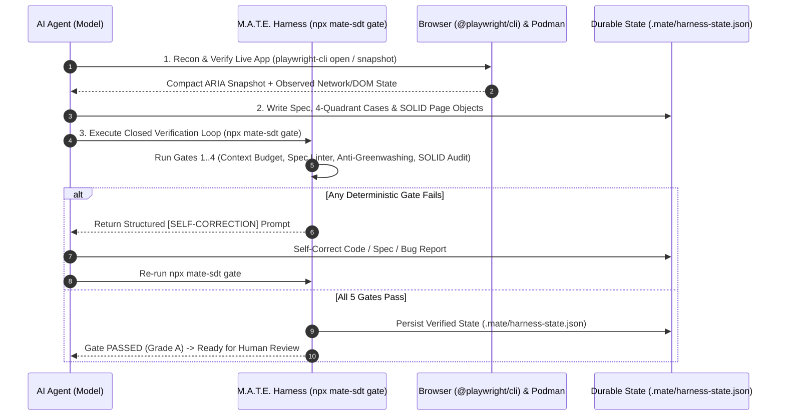

# 🧠⚙️ Context Engineering & Harness Engineering in M.A.T.E.

The **M.A.T.E. Method (`mate-sdt`)** is architected from the ground up upon the two foundational disciplines of modern AI Agent Engineering:

1. **Context Engineering:** Treating the LLM's context window as finite, high-stakes RAM by governing what information is **Written, Selected, Compressed, and Isolated** on every agent turn.
2. **Harness Engineering ($\text{Agent} = \text{Model} + \text{Harness}$):** Surrounding probabilistic language models with **deterministic verification loops, hard code guardrails, state persistence, and container sandboxes** so agents self-correct before presenting outputs to a human.

---

## Pillar I: Context Engineering (*Write, Select, Compress, Isolate*)

> *"More tokens do not equal better QA. Flooding an agent's context window with raw DOM dumps, 500-file repository scans, and unverified assumptions causes Context Rot, Context Poisoning, and Context Confusion."*

### 1. The 3 Failure Modes of Naive AI Testing Assistants
Without Context Engineering, AI coding and testing agents fail in predictable ways:
* **Context Rot (Distraction):** Dumping 80,000 tokens of raw HTML or scanning the entire repository on every prompt dilutes the model's attention budget, causing it to forget SOLID rules and invent duplicate Page Objects.
* **Context Poisoning:** When an agent guesses an undocumented SLA, API schema, or business rule and writes it into a prompt or test, subsequent turns treat that hallucination as verified truth.
* **Context Confusion:** Loading one massive monolithic skill or dozens of irrelevant tool definitions at once, degrading instruction-following accuracy.

---

### 2. How M.A.T.E. Implements the 4 Operations of Context Engineering


| Operation | M.A.T.E. Architectural Mechanism | How It Protects the Context Window |
| :--- | :--- | :--- |
| **1. WRITE**<br>*(Externalized Memory)* | **`MATE-PROJECT-MAP.md`**, `specs/*.mate-spec.md`, `docs/test-cases/TC-*.md`, and `.mate/harness-state.json`. | Persists the repository's module map, reusable Page/Component Objects, fixtures, and known bugs outside the volatile chat window so agents never scan the full repo. |
| **2. SELECT**<br>*(Just-In-Time Routing)* | **3-Tier Progressive Context Disclosure** across 15 granular skills with strict `USE WHEN:` and `SYNERGY:` triggers + `npx mate-sdt context <module>`. | **Tier 1 (`< 3,000 tokens`):** `MATE-PROJECT-MAP.md` + `mate-core`.<br>**Tier 2:** Only the active phase skill (e.g., `mate-pw-recon` *or* `mate-pw-codegen`).<br>**Tier 3:** Lazy-loaded `references/*.md` fetched only when needed. |
| **3. COMPRESS**<br>*(Signal-to-Noise)* | **`@playwright/cli` YAML ARIA Snapshots** (`e1`, `e2` refs) + XML-delimited spec blocks (`<intent_model>`, `<invariants>`). | Replaces 80k-token raw DOM dumps with `< 800-token` semantic ARIA trees; promotes discovered locators immediately into `src/pages/*.page.ts` and clears raw tool outputs. |
| **4. ISOLATE**<br>*(Anti-Poisoning)* | **Epistemic Provenance Tags (`[OBSERVED]`, `[INFERRED]`, `[TBD]`)** enforced by the Handling Uncertainty Protocol. | Strictly separates verified facts (`[OBSERVED]` in live browser/code) from assumptions (`[INFERRED]`) and missing knowledge (`[TBD]`), preventing Context Poisoning. |

### CLI Tooling for Context Engineering:
Run the **M.A.T.E. Context Analyzer & JIT Pack Assembler** at any time:
```bash
# Audit Tier-1 token budget, detect unindexed Page Objects (Context Drift), and check epistemic tags
npx mate-sdt context

# Generate a compressed Just-In-Time (JIT) Context Pack (.mate/context-pack-<module>.md) for a specific module
npx mate-sdt context checkout
```

---

## Pillar II: Harness Engineering ($\text{Agent} = \text{Model} + \text{Harness}$)

> *"Relying on system prompts ('please do not use waitForTimeout', 'please do not delete failing tests') is wishful thinking. A Harness enforces rules deterministically in code and loops errors back to the agent until objective gates pass."*

### 1. The 5 Components of the M.A.T.E. Agent Harness



1. **Tool Orchestration (`@playwright/cli` + MCPs + Podman):**
   Provides token-efficient browser control (`mate-pw-recon`, `mate-pw-codegen`, `mate-pw-forensics`), source-agnostic requirement ingestion (`mate-story-testcases`), and containerized execution (`mutate`, `k6`).
2. **Deterministic Guardrails (`src/cli/validator.js` & `src/cli/auditor.js`):**
   Hard-coded static analyzers that reject specs missing **Explicit Forbidden Transitions** and block test code containing `waitForTimeout()` (`MATE-ANTI-01`), `.only` (`MATE-ANTI-02`), direct `new *Page()` DIP violations (`MATE-ANTI-03`), weak assertions (`MATE-ANTI-04`), fragile XPath (`MATE-ANTI-05`), permissive discrepancy regexes (`MATE-ANTI-06`), or bloated single-case assertions in Page Objects (`MATE-ANTI-07`).
3. **Anti-Greenwashing Guardrail (`GATE-03`):**
   Deterministically cross-checks `test.fail()` / `test.fixme()` annotations in `tests/**/*.spec.ts` against `docs/bugs/BUG-*.md` so an AI agent can never silently hide a failing product requirement without generating a traceable Bug Report.
4. **Closed-Loop Verification & Self-Correction (`npx mate-sdt gate`):**
   Runs all 4 deterministic gates in a single pass and emits machine-actionable `[SELF-CORRECTION]` instructions (plus `--json` output) so the agent repairs its own mistakes before ending its turn.
5. **Durable State Persistence & Sandboxing (`.mate/harness-state.json` & Rootless Podman):**
   Persists verification state on disk across sessions and isolates destructive mutation (`Stryker`) and load testing (`Grafana k6`) inside ephemeral rootless **Podman** containers.

### CLI Tooling for Harness Engineering:
```bash
# Run the complete 5-Gate Closed Verification Loop
npx mate-sdt gate

# Emit machine-readable JSON with self-correction prompts for automated agent loops
npx mate-sdt gate --json
```

---

## 3. Sessions vs. Memory Architecture (May 2026 Standard)

`mate-sdt` separates ephemeral execution state from canonical long-term memory so heterogeneous AI runtimes (`Antigravity`, `Claude Code`, `Cursor`, `Windsurf`, `GitHub Copilot`, `Codex`) share one deterministic, framework-agnostic substrate:

1. **Session Workbench (`.mate/sessions/<flow-id>.json`, `.mate/scratchpad-<module>.md`, `.mate/handoffs/*.json`, `.mate/harness-state.json`):**
   - Stores chronological events, active workflow stage, and the last $K=5$ raw findings.
   - Enforces a **24h TTL** (`npx mate-sdt session prune`) and **rolling + event-based compaction** (automatically folds raw events into 3-line summaries when `events.length > 5` or on `npx mate-sdt session advance`).
   - Emits **`mate.handoff/v1` Black-Box Handoffs** ("Separate Individual Histories") between skills.
2. **Memory Filing Cabinet (`MATE-PROJECT-MAP.md`, `specs/*.mate-spec.md`, `.mate/memory/procedural-playbooks.md`):**
   - Stores **Declarative Memory** (*"Knowing What"*) and **Procedural Memory** (*"Knowing How"*).
   - **Self-Editing Consolidation (`npx mate-sdt context <module> --consolidate`):** Evaluates `[OBSERVED]` findings from scratchpads/sessions/CLI `--facts` and applies deterministic `CREATE`, `UPDATE`, `DELETE`, `CONFLICT`, or `NOOP` operations into `MATE-PROJECT-MAP.md` (`<!-- MATE-MEMORY:<module>:START/END -->`) and `.mate/memory/consolidation-log.jsonl`.
3. **3-Bucket / 7-Layer JIT Context Pack (`npx mate-sdt context <module>`):**
   - **Bucket 1 (System & Guardrails):** Phase-scoped role/rules, tool whitelist, and relevant few-shot examples.
   - **Bucket 2 (Memory & State):** `MATE-PROJECT-MAP.md` summary, blended memory slice (`0.5·Relevance + 0.2·Recency + 0.3·Importance`), upstream `mate.handoff/v1` digest, 3-line rolling summary + last $K=5$ findings, compressed ARIA snapshots (`<= 800` tokens), HAR/OpenAPI slices, and targeted spec XML blocks.
   - **Bucket 3 (Immediate Task & Output Contract):** Current goal and strict output schema.
4. **Eliminating the 4 Context Failure Modes (Enforced in `GATE-01`):**
   - **Poisoning:** Provenance hierarchy (`[BOOTSTRAPPED] > [USER_EXPLICIT] > [OBSERVED | ISO-timestamp] > [INFERRED] / [TBD]`); blocks `[INFERRED]`/`[TBD]` from `<invariants>` and `src/pages|components`; redacts PII/secrets and blocks indirect prompt injections.
   - **Distraction:** Rolling compaction + $K=5$ cap + ARIA compression (`<= 800` tokens).
   - **Confusion:** Phase-scoped tool/spec slicing via `--phase`.
   - **Clash:** Self-editing consolidation (`UPDATE`/`DELETE`/`CONFLICT`) and Black-Box Handoffs.

---

## 4. Harness Engineering: 6-Layer Forward-Only Architecture, 3 Loop Topologies & Continuous GC

> **Core Rule:** *Humans steer. Agents execute.* (`Agent = Model + Harness + Knowledge`)

1. **Forward-Only 6-Layer Dependency Direction (`GATE-04` / `npx mate-sdt audit`):**
   - `1. src/models/` (strict TS schemas, zero `any`) $\rightarrow$ `2. src/api/` & `src/components/` $\rightarrow$ `3. src/pages/` (`<= 300` lines) $\rightarrow$ `4. src/fixtures/` (`test.extend`) $\rightarrow$ `5. tests/{e2e,api,threats,nfr}/**/*.spec.ts`.
   - Backward imports, `new SomePage(page)` or raw `page.locator()` in specs, ad-hoc test helpers, and `waitForTimeout()` emit **Remediation-Injecting Lints** (`[SELF-CORRECTION][GATE-04][...]`).
2. **3 Harness Loop Topologies:**
   - **Linear Harness:** Deterministic single-pass (`npx mate-sdt validate`, `npx mate-sdt context`, `npx mate-sdt status`).
   - **Closed-Loop Verification Harness (`npx mate-sdt gate --loop`):** Runs all 5 gates up to `max_iterations = 5`, persisting `[SELF-CORRECTION]` payloads in `.mate/harness-state.json`.
   - **Safety-Guarded Harness:** `blockDestructiveCommands` + rootless Podman for `mutate`, `k6`, and `redteam`.
3. **Continuous Entropy & Doc-Gardening GC (`npx mate-sdt gc`):**
   - Scans for unindexed artifacts, broken cross-links, unmapped `INV-XX` invariants, duplicated test helpers, bloated Page Objects (`> 300` lines), stale `test.fail()` markers, and expired sessions.
   - Generates `docs/QUALITY_SCORE.md` (`A`–`F` per module) and updates `.mate/exec-plans/tech-debt-tracker.md`.
   - Execution plans for multi-step workflows live in `.mate/exec-plans/active/` and move to `.mate/exec-plans/completed/` upon completion.

---

## 5. Stack-Trace Entry Point & Spec-Guarded Self-Healing (`npx mate-sdt heal`)

When a user pastes a raw stack trace, Playwright `TimeoutError` / `StrictModeViolation`, HTTP `4xx/5xx` mismatch, or runs `npx mate-sdt heal [target]`:
1. **COMPRESS (`<error_digest> <= 400` tokens):** Strips ANSI codes and `node_modules/` frames, classifies `failure_signature`, maps `call_chain` across Forward-Only layers, and extracts the `delta`.
2. **SELECT & WRITE:** Maps the module to `specs/<module>.mate-spec.md` (`<intent_model>` + `<invariants>`), extracts `±25` lines around project frames, and writes `.mate/scratchpad-heal-<module>.md` (capped at 3 attempts).
3. **ISOLATE (3-Stage Black-Box Handoff):** `forensic-recon` $\rightarrow$ `root-cause-verdict` $\rightarrow$ `surgical-patch-or-quarantine`.
4. **5-Class Decision Matrix:** Auto-heals `UI_LOCATOR_DRIFT`, `SYNC_OR_FLAKY_RACE`, and `HARNESS_OR_TYPING_DRIFT`; halts for human confirmation on `SPEC_EVOLUTION_DRIFT`; and strictly quarantines `REAL_PRODUCT_BUG` with `test.fail(true, "BUG-XXX")` + `npx mate-sdt bug <module>` (`GATE-03` blocks assertion weakening).
