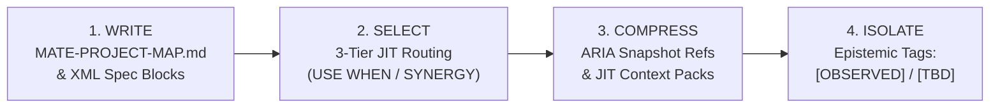
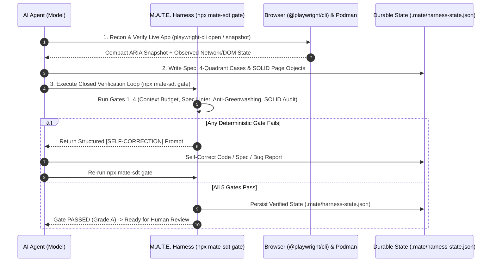

# 🧠⚙️ Context Engineering & Harness Engineering in M.A.T.E.

The **M.A.T.E. Method (`mate-sdt`)** is architected from the ground up upon the two foundational disciplines of modern AI Agent Engineering:

1. **Context Engineering:** Treating the LLM's context window as finite, high-stakes RAM by governing what information is **Written, Selected, Compressed, and Isolated** on every agent turn.
2. **Harness Engineering ($\text{Agent} = \text{Model} + \text{Harness}$):** Surrounding probabilistic language models with **deterministic verification loops, hard code guardrails, state persistence, and container sandboxes** so agents self-correct before presenting outputs to a human.

---

## Pillar I: Context Engineering (*Write, Select, Compress, Isolate*)

> *"More tokens do not equal better QA. Flooding an agent's context window with raw DOM dumps, 500-file repository scans, and unverified assumptions causes Context Rot, Context Poisoning, and Context Confusion."*

### 1. The 3 Failure Modes of Naive AI Testing Assistants
Without Context Engineering, AI coding and testing agents fail in predictable ways:
* **Context Rot (Distraction):** Dumping 80,000 tokens of raw HTML or scanning the entire repository on every prompt dilutes the model's attention budget, causing it to forget SOLID rules and invent duplicate Page Objects.
* **Context Poisoning:** When an agent guesses an undocumented SLA, API schema, or business rule and writes it into a prompt or test, subsequent turns treat that hallucination as verified truth.
* **Context Confusion:** Loading one massive monolithic skill or dozens of irrelevant tool definitions at once, degrading instruction-following accuracy.

---

### 2. How M.A.T.E. Implements the 4 Operations of Context Engineering



| Operation | M.A.T.E. Architectural Mechanism | How It Protects the Context Window |
| :--- | :--- | :--- |
| **1. WRITE**<br>*(Externalized Memory)* | **`MATE-PROJECT-MAP.md`**, `specs/*.mate-spec.md`, `tests/cases/TC-*.md`, and `.mate/harness-state.json`. | Persists the repository's module map, reusable Page/Component Objects, fixtures, and known bugs outside the volatile chat window so agents never scan the full repo. |
| **2. SELECT**<br>*(Just-In-Time Routing)* | **3-Tier Progressive Context Disclosure** across 15 granular skills with strict `USE WHEN:` and `SYNERGY:` triggers + `npx mate-sdt context <module>`. | **Tier 1 (`< 3,000 tokens`):** `MATE-PROJECT-MAP.md` + `mate-core`.<br>**Tier 2:** Only the active phase skill (e.g., `mate-pw-recon` *or* `mate-pw-codegen`).<br>**Tier 3:** Lazy-loaded `references/*.md` fetched only when needed. |
| **3. COMPRESS**<br>*(Signal-to-Noise)* | **`@playwright/cli` YAML ARIA Snapshots** (`e1`, `e2` refs) + XML-delimited spec blocks (`<intent_model>`, `<invariants>`). | Replaces 80k-token raw DOM dumps with `< 800-token` semantic ARIA trees; promotes discovered locators immediately into `src/pages/*.page.ts` and clears raw tool outputs. |
| **4. ISOLATE**<br>*(Anti-Poisoning)* | **Epistemic Provenance Tags (`[OBSERVED]`, `[INFERRED]`, `[TBD]`)** enforced by the Handling Uncertainty Protocol. | Strictly separates verified facts (`[OBSERVED]` in live browser/code) from assumptions (`[INFERRED]`) and missing knowledge (`[TBD]`), preventing Context Poisoning. |

### CLI Tooling for Context Engineering:
Run the **M.A.T.E. Context Analyzer & JIT Pack Assembler** at any time:
```bash
# Audit Tier-1 token budget, detect unindexed Page Objects (Context Drift), and check epistemic tags
npx mate-sdt context

# Generate a compressed Just-In-Time (JIT) Context Pack (.mate/context-pack-<module>.md) for a specific module
npx mate-sdt context checkout
```

---

## Pillar II: Harness Engineering ($\text{Agent} = \text{Model} + \text{Harness}$)

> *"Relying on system prompts ('please do not use waitForTimeout', 'please do not delete failing tests') is wishful thinking. A Harness enforces rules deterministically in code and loops errors back to the agent until objective gates pass."*

### 1. The 5 Components of the M.A.T.E. Agent Harness



1. **Tool Orchestration (`@playwright/cli` + MCPs + Podman):**
   Provides token-efficient browser control (`mate-pw-recon`, `mate-pw-codegen`, `mate-pw-forensics`), source-agnostic requirement ingestion (`mate-story-testcases`), and containerized execution (`mutate`, `k6`).
2. **Deterministic Guardrails (`src/cli/validator.js` & `src/cli/auditor.js`):**
   Hard-coded static analyzers that reject specs missing **Explicit Forbidden Transitions** and block test code containing `waitForTimeout()` (`MATE-ANTI-01`), `.only` (`MATE-ANTI-02`), direct `new *Page()` DIP violations (`MATE-ANTI-03`), weak assertions (`MATE-ANTI-04`), fragile XPath (`MATE-ANTI-05`), or hardcoded secrets (`MATE-ANTI-06`).
3. **Anti-Greenwashing Guardrail (`GATE-03`):**
   Deterministically cross-checks `test.fail()` / `test.fixme()` annotations in `tests/**/*.spec.ts` against `tests/bugs/BUG-*.md` so an AI agent can never silently hide a failing product requirement without generating a traceable Bug Report.
4. **Closed-Loop Verification & Self-Correction (`npx mate-sdt gate`):**
   Runs all 4 deterministic gates in a single pass and emits machine-actionable `[SELF-CORRECTION]` instructions (plus `--json` output) so the agent repairs its own mistakes before ending its turn.
5. **Durable State Persistence & Sandboxing (`.mate/harness-state.json` & Rootless Podman):**
   Persists verification state on disk across sessions and isolates destructive mutation (`Stryker`) and load testing (`Grafana k6`) inside ephemeral rootless **Podman** containers.

### CLI Tooling for Harness Engineering:
```bash
# Run the complete 5-Gate Closed Verification Loop
npx mate-sdt gate

# Emit machine-readable JSON with self-correction prompts for automated agent loops
npx mate-sdt gate --json
```
