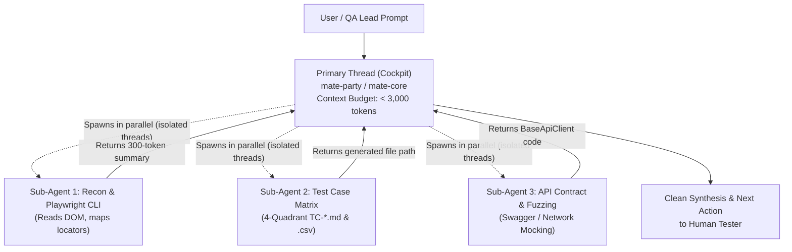

# 🤖⚡ Sub-Agent Forking & Parallel Execution in M.A.T.E.

The **M.A.T.E. Method (`mate-sdt`)** is engineered for the **Agentic AI Era**. One of the primary causes of LLM failure in Quality Engineering is **Context Rot & Context Bloat**: flooding the primary conversation thread with thousands of lines of raw HTML, 500-span OpenTelemetry traces, or verbose test runner logs.

To preserve the primary thread as a lean, high-level reasoning cockpit (`< 3,000 tokens` Tier-1 budget), M.A.T.E. defines the **Sub-Agent Forking Protocol**: whenever the host AI environment supports background sub-agents, heavy reconnaissance, trace auditing, and test generation tasks **MUST be delegated to isolated, parallel sub-threads**.

---

## 🏛️ 1. Why Sub-Agent Isolation Matters (Context Engineering)



| Without Sub-Agents (Naive Approach) | With M.A.T.E. Sub-Agent Forking Protocol |
| :--- | :--- |
| Primary chat receives 80,000 tokens of raw DOM dumps from `playwright-cli open`. | Sub-Agent runs in background, extracts ARIA locators, creates `src/pages/*.page.ts`, and replies with a **200-token summary**. |
| Main agent forgets SOLID rules and Anti-Greenwashing invariants due to token saturation. | Main thread maintains 100% adherence to `MATE-PROJECT-MAP.md` and quality gates. |
| Steps execute sequentially, taking 5 to 10 minutes. | Recon, Test Case authoring, and API discovery run **concurrently in parallel threads**. |

---

## 🛠️ 2. Platform-Agnostic Execution Guide

Different AI coding assistants provide distinct primitives for spawning isolated sub-agents. M.A.T.E. adapts dynamically:

### A. Google Antigravity & `agy` CLI
*   **Mechanism:** `invoke_subagent` and `swarm add`.
*   **Workspace Isolation:** Uses `Workspace: "inherit"` for read-only research, or `Workspace: "share"` / `Workspace: "branch"` when generating code in parallel without write conflicts.
*   **Reactive Wakeup:** The main agent stops calling tools and goes to sleep; the system automatically wakes it when sub-agents post results.

### B. Claude Code (Anthropic)
*   **Mechanism:** The `Agent` tool (`subagent_type`, isolated task prompts).
*   **Isolation:** The sub-agent executes in a child process sandbox. Output is captured, compressed, and returned as a single tool response without polluting the parent transcript.

### C. Cursor (Agent Mode & Composer) / Windsurf (Cascade)
*   **Mechanism:** Asynchronous terminal runners, background tasks, and dedicated composer sub-threads (`@file` and rule-scoped).

---

## 📋 3. The 3 M.A.T.E. Sub-Agent Templates

When forking a task, use these standardized prompts to guarantee deterministic results:

### Template 1: The Live Browser Recon Sub-Agent (`mate-pw-recon`)
```text
ROLE: Playwright CLI Live Reconnaissance Specialist
TASK: Navigate to [TARGET_URL], explore the user journey [FLOW_NAME], and map deterministic semantic locators using @playwright/cli.
CONSTRAINTS:
1. Do NOT dump raw HTML to the parent thread.
2. Generate or update src/pages/[feature].page.ts extending BasePage (OOP/SOLID).
3. Verify locators live using `playwright-cli eval` or `playwright-cli snapshot`.
4. Output only: File path created, locators verified, and any [OBSERVED] app bugs.
```

### Template 2: The 4-Quadrant Test Case Designer (`mate-story-testcases`)
```text
ROLE: 4-Quadrant QA Test Case Architect
TASK: Ingest User Story [TICKET_REF_OR_TEXT] and generate docs/test-cases/TC-[module].md and .csv.
CONSTRAINTS:
1. Cover Happy Paths, Border/Boundary limits, Negative Paths, and Forbidden Transitions.
2. Classify every test into [AUTOMATE_UI], [AUTOMATE_API], [MANUAL_TEST], or [EXPLORATORY_CHARTER].
3. For [MANUAL_TEST], include step-by-step instructions and explicit rationale on why automation is not recommended.
4. Output only: Test case count summary and file links.
```

### Template 3: The AI Trace & Observability Auditor (`mate-ai-observability`)
```text
ROLE: OpenTelemetry & LLM Trace Forensics Auditor
TASK: Audit traces in [TRACE_FILE_OR_ENDPOINT] for agent loops, token limits, and failure root cause.
CONSTRAINTS:
1. Parse AGENT, RETRIEVAL, TOOL, and LLM spans.
2. Isolate defects into [RETRIEVER_DEFECT] vs [GENERATOR_DEFECT].
3. Detect infinite tool loops or prompt injection traces.
4. Output only: Executive verdict, defect classification, and recommended Golden Dataset entries.
```

### Template 4: The Playwright Execution & Triage Runner (`mate-triage` + `mate-assert-playwright`)
```text
ROLE: M.A.T.E. Test Execution & Triage Specialist
TASK: Execute test suite `[SPEC_PATH_OR_CMD]` (e.g. `npx playwright test tests/e2e/[module].spec.ts`).
CONSTRAINTS (CRITICAL CONTEXT BUDGET):
1. Do NOT dump raw stdout, color ANSI codes, or verbose 500-line stack traces to the parent cockpit thread.
2. If tests PASS: Return only exit code, test count, and total duration (e.g., "✅ 4/4 tests passed in 3.2s").
3. If tests FAIL: Extract ONLY:
   - Failing test case name and line number.
   - Exact assertion difference (`Expected` vs `Received`).
   - Spec Invariant violated (`INV-XX`).
   - Attached screenshot, video, or trace zip path.
4. If an application bug is confirmed, draft or update docs/bugs/BUG-[module].md.
5. Output only: 5-to-10 line compressed execution verdict.
```

---

## ⚡ 4. Workflows with Parallel Eligibility (`[PARALLEL_SUBAGENT_ELIGIBLE]`)

The following M.A.T.E. workflows explicitly flag steps that can be run concurrently by sub-agents:

1. **`/mate-flow-user-story`:**
   - *Phase 1:* Sub-Agent A generates `TC-*.md` matrices while Sub-Agent B runs `@playwright/cli` live recon on the staging environment.
   - *Phase 5:* Test execution and triage run in an isolated Sub-Agent, keeping the main cockpit thread under 3,000 tokens.
2. **`/mate-flow-zero-to-one`:**
   - *Phase 2:* Sub-Agent A builds the Risk Matrix (`TEST-STRATEGY.md`) while Sub-Agent B maps the smoke journey locators in `src/pages/`.
3. **`/mate-flow-ai-agent`:**
   - *Phase 2 & 3:* Promptfoo functional evals and OWASP Red-Teaming run concurrently in separate sub-agent execution runs.
4. **`/mate-flow-brownfield` & `/mate-flow-triage`:**
   - Full suite execution and Stryker mutation testing run in isolated runner sub-agents without polluting the parent transcript.
