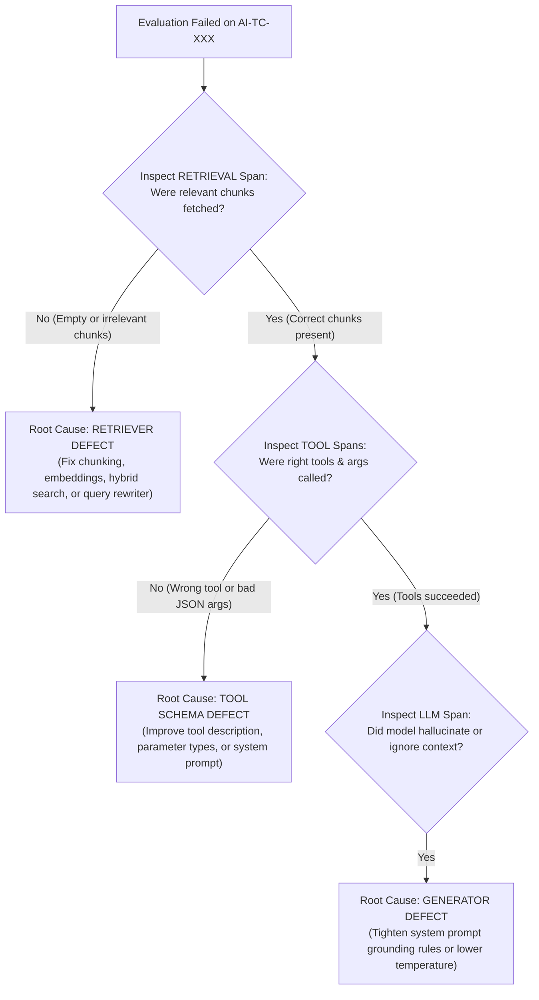

# 📡 OpenTelemetry, OpenInference, Langfuse & Arize Phoenix Guide (`mate-ai-observability`)

This reference explains how to connect your AI Agent or RAG pipeline to **Langfuse** or **Arize Phoenix** via OpenTelemetry/OpenInference and how to use those traces for M.A.T.E. root-cause triage.

---

## 1. Choosing Your Observability Backend

| Feature | Langfuse (Open Source / Cloud) | Arize Phoenix (Open Source / Local-First) |
| :--- | :--- | :--- |
| **Primary Strength** | Production session tracking, prompt versioning, user cost analytics, and dataset curation UI. | Local-first RAG & Agent debugging, embedding drift visualization, and trace clustering. |
| **Quick Local Start** | `podman compose up` (Langfuse stack) or Cloud Free Tier | `pip install arize-phoenix && phoenix serve` (runs on `http://localhost:6006`) |
| **OTLP Endpoint** | `https://cloud.langfuse.com/api/public/otel/v1/traces` | `http://localhost:6006/v1/traces` |

---

## 2. Root-Cause Triage Decision Tree Using Traces

When a test in `mate-ai-evals` fails, inspect the trace waterfall from top to bottom:

---

## 3. Exporting Production Traces into M.A.T.E. Golden Datasets

Whenever a trace in Langfuse or Phoenix exposes a bug:
1. Export the trace JSON to `tests/ai-evals/traces/trace-<id>.json`.
2. Run the M.A.T.E. Trace Auditor (`node tests/ai-evals/traces/otel_trace_auditor.js`) to inspect token, step, and tool budgets.
3. Add a new regression test case to `tests/ai-evals/datasets/DS-<module>.json` with `"provenance": "[PROD_TRACE_REGRESSION]"`.
