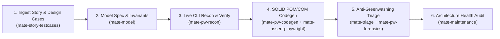

# 📋 Workflow: `/mate-flow-user-story` (User Story to E2E Automation & Triage)

This workflow orchestrates the complete daily engineering loop for a Quality Engineer working with a **User Story, Ticket, or Requirement Document** across 7 synergistic M.A.T.E. skills.



---

## Step 1: Read Living Map & Ingest User Story (`mate-core` + `mate-story-testcases`)
1. Read `MATE-PROJECT-MAP.md` first to understand the project's domain modules, existing Page Objects, Component Objects, and Fixtures.
2. Ingest the User Story from the source provided by the tester:
   - **Atlassian MCP (Jira / Confluence / Xray):** Fetch the issue summary, description, acceptance criteria, and linked pages via MCP.
   - **Notion / Linear / GitHub Issues MCP:** Fetch the requirement page or ticket via MCP.
   - **Local File (`.xlsx`, `.csv`, `.md`, `.txt`) or Pasted Text:** Read the file or text directly.
3. Apply the **Handling Uncertainty Protocol**: if an acceptance criterion is ambiguous or contradictory, ask the tester or flag `[TBD]`.

---

## Step 2: Formalize Spec & 4-Quadrant Test Case Matrix (`mate-model` + `mate-story-testcases`)
1. Create or update `specs/[module].mate-spec.md` with `<intent_model>` (including **Explicit Forbidden Transitions**), `<invariants>` (`INV-01..INV-NN`), `<threat_scenarios>`, and `<exploratory_charters>`.
2. Run `npx mate-sdt validate specs/[module].mate-spec.md`.
3. Generate the dual Test Case Matrix (`npx mate-sdt cases <module>`):
   - `tests/cases/TC-[module].md` (Markdown traceability matrix)
   - `tests/cases/TC-[module].csv` (CSV ready for Jira/Xray/Zephyr/Excel/Notion import)
4. Ensure mandatory coverage across all 4 quadrants:
   - **`[HAPPY_PATH]`**: Every valid Acceptance Criterion.
   - **`[BORDER_CASE]`**: Boundary Value Analysis (`0`, min, max, max+1, empty, special chars/Unicode).
   - **`[NEGATIVE_PATH]`**: Missing required fields, invalid formats, unauthorized access, backend `4xx`/`5xx` error handling.
   - **`[STATE_TRANSITION]`**: Forbidden transitions, double-click submit idempotency, refresh/back navigation.

---

## Step 3: Validate Live Behavior with `@playwright/cli` (`mate-pw-recon`)
1. Open the running application via `playwright-cli open <url>`.
2. Inspect the ARIA tree (`playwright-cli snapshot`) and walk through the designed test cases (`HAPPY_PATH`, `BORDER_CASE`, `NEGATIVE_PATH`) interactively using `fill`, `click`, `select`, `eval`, `console`, and `network`.
3. Extract semantic locators (`getByRole`, `getByLabel`, `getByTestId`) and identify reusable `BaseComponent` vs. `BasePage` boundaries.
4. Record the honest live result (`✅ PASS` vs. `❌ FAIL`) for each `TC-XX` in `tests/cases/TC-[module].md` and `.csv`.
5. Close the CLI browser session (`playwright-cli close`).

---

## Step 4: Automate All Cases with SOLID Architecture (`mate-pw-codegen` + `mate-assert-playwright`)
1. Encapsulate discovered locators and actions into:
   - `src/components/<widget>.component.ts` (extending `BaseComponent`)
   - `src/pages/<module>.page.ts` (extending `BasePage`)
   - `src/fixtures/mate.fixtures.ts` (`test.extend<MateFixtures>`)
2. Register new classes and fixtures in `MATE-PROJECT-MAP.md`.
3. Write the automated test suite in `tests/e2e/<module>.spec.ts` covering **100% of the Automatable Test Cases** (`@happy`, `@border`, `@negative`, `@fsm`).
4. **ENFORCE THE ANTI-GREENWASHING MANDATE:**
   - **Never skip, delete, or weaken a test case just because the application currently fails it!**
   - If `TC-XX` fails against the live application (because of a real product bug violating the User Story / `INV-YY`), **write the test with the true expected assertion** and annotate it with:
     ```typescript
     test.fail(true, 'BUG-YYYYMMDD-MOD-01: App violates AC-02 / INV-02 on TC-XX');
     ```

---

## Step 5: Forensic Evidence & Bug Reporting (`mate-triage` + `mate-pw-forensics`)
1. Execute the automated test suite (`npx playwright test tests/e2e/<module>.spec.ts`).
2. For every test case that exposed a real application bug:
   - Capture screenshot/trace/video evidence via `mate-pw-forensics` if not already captured.
   - Generate a spec-linked Bug Report in `tests/bugs/` via `npx mate-sdt bug <module>`.
   - If an Atlassian/Jira, GitHub Issues, or Notion MCP is connected and the tester requests it, sync or comment the bug report and test cases back to the ticket.

---

## Step 6: Architectural Health Gate & Final Tester Report (`mate-maintenance`)
1. Run `npx mate-sdt audit` to confirm `Grade A (100/100)` compliance (zero `waitForTimeout`, zero `.only`, 100% DIP fixture usage).
2. Present a clear **Daily QA Execution Summary** to the tester:
   - **Total Test Cases Designed & Automated:** `N` (`Happy`, `Border`, `Negative`, `State`)
   - **Passing Tests (`✅ PASS`):** List of verified working scenarios.
   - **Failing Tests Exposing Real Bugs (`⚠️ KNOWN FAIL — test.fail()`):** Explicit callout of which User Story requirements failed, the generated `tests/bugs/BUG-*.md` file paths, and the exact `test.fail()` guards added to the suite.
